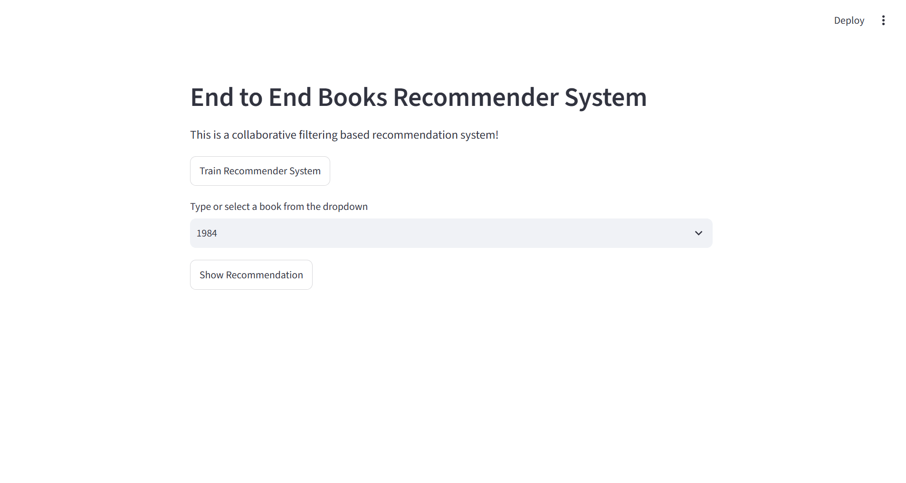

<div align="center">

# 📚 Book Recommender MLOps
### End-to-End Collaborative Filtering Recommendation System

**Python · Scikit-learn · Pandas · SciPy · Streamlit · MLflow · DVC · Docker · AWS (deployment roadmap)**

[](https://www.python.org/)
[](https://scikit-learn.org/)
[](https://streamlit.io/)
[](https://mlflow.org/)
[](https://dvc.org/)
[](https://www.docker.com/)

**Author: Tushar Nile**

[GitHub Repository](https://github.com/tusharaitechie/Book-Recommender-MLOps) · [Reference Project](https://github.com/entbappy/End-to-End-Book-Recommender-System)

</div>

---

## 📌 Project Overview

Book Recommender MLOps is an end-to-end machine learning project that recommends books similar to a book selected by the user. It uses **collaborative filtering**: historical user–book ratings are transformed into a book–user matrix, and a Nearest Neighbors model finds books with similar rating patterns.

The project is designed to demonstrate more than model training. It separates the workflow into reusable pipeline stages and incorporates experiment tracking, data/pipeline versioning, a Streamlit user interface, and containerization.

### Highlights

- Collaborative filtering using historical book ratings.
- User–book pivot matrix and SciPy CSR sparse representation.
- Scikit-learn `NearestNeighbors` with cosine distance.
- Four modular pipeline stages: ingestion, validation, transformation, and training.
- MLflow tracking for parameters, metrics, tags, and model artifacts.
- DVC pipeline definition and reproducibility workflow.
- Streamlit application for selecting a book and viewing recommendations.
- Dockerfile for containerized execution.
- Documented AWS S3, EC2, and optional ECR deployment path.

> **Implementation transparency:** The local ML pipeline, MLflow integration, DVC pipeline definition, and Streamlit application are part of the project. The accompanying project documentation identifies the DVC S3 remote and AWS push/pull as pending. AWS steps in this README are an implementation guide, not a claim that cloud deployment is already live.

---

## 🖥️ Live Application Preview

The screenshot below shows the Streamlit interface. Users can train the recommender, select a book (for example, *1984*), and request recommendations.



### Application workflow

1. Launch the Streamlit application.
2. Select or type a book title in the dropdown.
3. Click **Show Recommendation**.
4. The application uses the trained model to retrieve similar books and displays recommendation details and cover images when available.
5. Use **Train Recommender System** to run the training workflow when the required data and environment are available.

---

## 🏗️ System Architecture

### Machine learning pipeline

```text
Book-Crossing Dataset
        |
        v
00. DATA INGESTION
Download and extract source files
        |
        v
01. DATA VALIDATION
Select, clean, filter and join data
        |
        v
02. DATA TRANSFORMATION
Create book-user rating pivot matrix
        |
        v
03. MODEL TRAINING
CSR sparse matrix + NearestNeighbors
        |
        v
      model.pkl
        |
        v
Recommendation inference
        |
        v
Streamlit application
        |
        v
Recommended books + cover images
```

### MLOps workflow

```text
       Git / GitHub
      (source code)
            |
            v
      DVC pipeline
     dvc.yaml / lock
            |
       +----+-----+
       |          |
       v          v
  Local cache   Reproducible stages
       |
       +---- Future configured remote ----> Amazon S3

  Training pipeline ----------------------> MLflow
                                             |
                              Parameters / Metrics / Artifacts
```

---

## 📖 Dataset

The project configuration downloads the Book-Crossing dataset. Its principal files are:

| File | Description |
|---|---|
| `BX-Books.csv` | Book metadata such as ISBN, title, author, publication year, publisher, and image URLs |
| `BX-Book-Ratings.csv` | User IDs, ISBNs, and book ratings |
| `BX-Users.csv` | User-related dataset information |

The recommendation workflow primarily uses book metadata and rating records.

## 🧠 Recommendation Algorithm

### Collaborative filtering

Collaborative filtering recommends items by identifying patterns in user interactions. In this project, books are represented by the ratings they receive from users. Books with similar rating patterns are treated as neighbors.

### Data preparation

The validation workflow documented for this project performs the following operations:

1. Loads the books and ratings CSV files.
2. Selects required columns and standardizes column names.
3. Filters active users with more than 200 ratings.
4. Joins book metadata and ratings using `ISBN`.
5. Counts ratings for each title and retains titles with at least 50 ratings.
6. Removes duplicate user–book rating records.
7. Saves the cleaned dataset and serialized rating data.

These thresholds describe the current project configuration and can be adjusted for experimentation.

### User–book pivot matrix

The transformation stage creates a matrix in which:

- Rows represent book titles.
- Columns represent user IDs.
- Values represent user ratings.
- Missing rating entries are filled with `0` for the pivot representation.

### Model training

The model trainer converts the pivot matrix into a SciPy CSR sparse matrix and fits Scikit-learn's `NearestNeighbors` estimator.

| Setting | Current training configuration |
|---|---|
| Estimator | `sklearn.neighbors.NearestNeighbors` |
| Search algorithm | `brute` |
| Distance metric | `cosine` |
| Number of neighbors | `5` |
| Input | SciPy CSR sparse matrix |
| Model artifact | `model.pkl` |

The trainer also records book/user counts, non-zero matrix values, sparsity, and training duration. The Streamlit inference code requests six neighbors; if model settings are changed, keep training and inference configuration consistent.

### Recommendation inference

When a title is selected, the application finds its row in the pivot matrix, queries the fitted nearest-neighbor model, maps returned indices to book titles, and retrieves cover-image URLs from the cleaned data for display.

---

## 🔄 Pipeline Stages

### Stage 00 — Data Ingestion

**Module:** `books_recommender/components/stage_00_data_ingestion.py`

- Reads the dataset URL and paths from `config/config.yaml`.
- Creates required directories.
- Downloads the dataset archive.
- Extracts source CSV files into the ingested-data directory.

Expected data layout:

```text
artifacts/dataset/
├── raw_data/
│   └── books_data.zip
└── ingested_data/
    ├── BX-Books.csv
    ├── BX-Book-Ratings.csv
    └── BX-Users.csv
```

### Stage 01 — Data Validation

**Module:** `books_recommender/components/stage_01_data_validation.py`

- Loads and selects relevant source columns.
- Filters active users and frequently rated titles.
- Merges book metadata with rating records.
- Removes duplicate user/title records.
- Saves clean data and serialized rating data.

Expected outputs:

```text
artifacts/
├── dataset/clean_data/clean_data.csv
└── serialized_objects/final_rating.pkl
```

### Stage 02 — Data Transformation

**Module:** `books_recommender/components/stage_02_data_transformation.py`

- Loads the cleaned rating dataset.
- Creates the title-by-user pivot matrix.
- Fills missing matrix entries with zero.
- Serializes the transformed matrix and book index.

Expected outputs:

```text
artifacts/
├── dataset/transformed_data/transformed_data.pkl
└── serialized_objects/
    ├── book_names.pkl
    └── book_pivot.pkl
```

### Stage 03 — Model Training

**Module:** `books_recommender/components/stage_03_model_trainer.py`

- Loads the transformed pivot matrix.
- Converts it to CSR sparse format.
- Fits the cosine-distance Nearest Neighbors model.
- Persists the trained estimator as `model.pkl`.
- Logs model configuration and training statistics to MLflow.

Expected output: `artifacts/trained_model/model.pkl`.

---

## 📊 MLflow — Experiment Tracking

**Project modules:** `mlops/mlflow_config.py` and `books_recommender/pipeline/training_pipeline.py`

MLflow records training runs so that model configurations, metrics, and artifacts can be inspected rather than relying only on terminal output.

| Tracking item | Logged information |
|---|---|
| Experiment | `Book-Recommender-Experiments` |
| Run | `Book-Recommender-Training` |
| Backend | Local SQLite: `sqlite:///mlflow.db` |
| Parameters | Algorithm, neighbor count, distance metric |
| Model/data metrics | Number of books, users, non-zero values, sparsity, training time |
| Pipeline metrics | Ingestion, validation, transformation, training, total pipeline time |
| Tags | Project, author, pipeline, framework, model type, run status |
| Artifact | Trained model artifact |

Start the local MLflow UI after running the pipeline:

```bash
mlflow ui --backend-store-uri sqlite:///mlflow.db --host 127.0.0.1 --port 5000
```

Open `http://127.0.0.1:5000` in your browser.

The SQLite tracking database and local artifacts are not automatically shared with other machines. A remote tracking server and remote artifact store would be a separate enhancement.

---

## 🧬 DVC — Data & Pipeline Versioning

DVC complements Git by tracking data dependencies and defining reproducible pipeline stages.

### Important files

- `.dvc/` — DVC project metadata and configuration.
- `.dvcignore` — patterns DVC should ignore.
- `dvc.yaml` — stage commands, dependencies, and outputs.
- `dvc.lock` — generated record of the pipeline dependency/output state.
- Local DVC cache — stores content-addressed data and artifacts.

### Pipeline stages

| DVC stage | Purpose | Main outputs |
|---|---|---|
| `data_ingestion` | Download and extract dataset | Raw and ingested data |
| `data_validation` | Clean, filter, and join data | Clean data and `final_rating.pkl` |
| `data_transformation` | Build rating pivot matrix | Transformed data, `book_names.pkl`, `book_pivot.pkl` |
| `model_training` | Fit recommendation model | `model.pkl` |

### Useful commands

```bash
# Inspect pipeline graph
dvc dag

# Check pipeline/data status
dvc status

# Reproduce stages whose dependencies have changed
dvc repro

# Diagnose DVC installation/configuration
dvc doctor

# List DVC-tracked files
dvc list . --dvc-only
```

> If you cloned this existing repository, do not run `dvc init` again. Use the existing DVC project configuration.

---

## 🗂️ Repository Structure

```text
Book-Recommender-MLOps/
│
├── .dvc/                         # DVC project metadata
├── artifacts/                    # Generated data and model artifacts
│   ├── dataset/
│   │   ├── raw_data/
│   │   ├── ingested_data/
│   │   ├── clean_data/
│   │   └── transformed_data/
│   ├── serialized_objects/
│   └── trained_model/
│
├── books_recommender/
│   ├── components/                # Four ML pipeline components
│   ├── pipeline/                  # Stage and training orchestration
│   ├── config/                    # Configuration management
│   ├── entity/                    # Configuration/data entities
│   ├── logger/                    # Logging utilities
│   ├── exception/                 # Custom exception handling
│   └── utils/                     # Shared utilities
│
├── config/
│   └── config.yaml                # Dataset URL and artifact paths
├── mlops/
│   └── mlflow_config.py           # MLflow configuration
├── notebook/                      # Notebook-based exploration
├── templates/                     # UI-related serialized resources
├── docs/
│   └── images/
│       └── book-recommender-demo.png
├── app.py                         # Streamlit application
├── main.py                        # Main entry point
├── template.py                    # Project/template utility
├── dvc.yaml                       # DVC pipeline definition
├── dvc.lock                       # DVC lock file
├── Dockerfile                     # Container configuration
├── requirements.txt               # Python dependencies
├── setup.py                       # Package setup
├── .gitignore
├── .dockerignore
└── README.md
```

Generated artifact files may not be present in a fresh clone until the pipeline is run or DVC artifacts are pulled.

---

## ⚙️ Local Installation & Execution

### Prerequisites

- Git
- Python 3.11 (the project documentation records Python 3.11.18 for the local environment)
- pip
- DVC
- Optional: Docker

### 1. Clone the repository

```bash
git clone https://github.com/tusharaitechie/Book-Recommender-MLOps.git
cd Book-Recommender-MLOps
```

### 2. Create a virtual environment

**Windows PowerShell:**

```powershell
py -3.11 -m venv venv
.\venv\Scripts\Activate.ps1
```

**Linux / macOS:**

```bash
python3.11 -m venv venv
source venv/bin/activate
```

### 3. Install dependencies

```bash
python -m pip install --upgrade pip
pip install -r requirements.txt
```

For DVC with S3 support:

```bash
pip install "dvc[s3]"
```

### 4. Run the pipeline

Run the complete DVC pipeline:

```bash
dvc repro
```

Alternatively, the documented stage runner can be used stage by stage:

```bash
python -m books_recommender.pipeline.stage_pipeline --stage data_ingestion
python -m books_recommender.pipeline.stage_pipeline --stage data_validation
python -m books_recommender.pipeline.stage_pipeline --stage data_transformation
python -m books_recommender.pipeline.stage_pipeline --stage model_training
```

### 5. Launch the Streamlit app

```bash
streamlit run app.py
```

Open the local URL printed by Streamlit, normally `http://localhost:8501`.

> **First-run note:** The application needs the configured serialized book index and trained model artifacts. Run the pipeline first if those files are not already available locally.

---

## 🐳 Docker

The repository includes a Dockerfile intended to run the Streamlit application on port `8501`.

```bash
# Build image
docker build -t book-recommender-mlops .

# Run container
docker run --name book-recommender -p 8501:8501 book-recommender-mlops
```

Open `http://localhost:8501`.

Useful commands:

```bash
docker ps
docker logs book-recommender
docker stop book-recommender
docker rm book-recommender
```

**Compatibility check before deployment:** The repository Dockerfile uses `python:3.7-slim-buster`, while the local project documentation records Python 3.11.18 and MLflow 3.17.2. These versions may not be compatible. Update the Docker base image to a supported Python version, align dependencies, and verify a clean Docker build and application startup before using this image in production.

---

# ☁️ AWS Cloud Setup & Deployment Guide

This section gives the next-step AWS implementation path for remote DVC artifact storage and hosting the Streamlit application. These are setup instructions; they should be marked complete only after the steps have been implemented and tested in your AWS account.

## AWS architecture

```text
Developer Machine                         AWS Cloud
-----------------                         ---------
Git push / clone  ----------------------> GitHub
DVC pipeline
     |
     v
Local DVC cache  -- dvc push ----------> Amazon S3
                                            |
                                      dvc pull from EC2
                                            |
                                            v
                                       Amazon EC2
                                      Docker Engine
                                            |
                                      Streamlit :8501

Optional image workflow: Docker image ---> Amazon ECR ---> EC2 pull
```

## Part A — Configure Amazon S3 as a DVC remote

### Step 1. Create an S3 bucket

1. Sign in to the [AWS Management Console](https://console.aws.amazon.com/).
2. Open **Amazon S3** and select **Create bucket**.
3. Enter a globally unique name, for example `book-recommender-mlops-artifacts`.
4. Select the region you plan to use.
5. Keep **Block all public access** enabled.
6. Optionally enable bucket versioning for additional object-history protection.
7. Create the bucket.

Keep the bucket private. DVC should access it using AWS identity and permissions, not public bucket access.

### Step 2. Create least-privilege IAM access

1. Open **IAM** in the AWS Console.
2. Create a dedicated IAM identity for the DVC workflow (a role is preferred for AWS compute; a user/access key may be used for a local workstation if necessary).
3. Grant only the required S3 list/read/write permissions for the specific bucket and project prefix.
4. Do not use root-account credentials.
5. Never commit access keys, secret keys, or session tokens to GitHub.

### Step 3. Install and configure AWS CLI

Install the AWS CLI using the official AWS instructions, then configure local credentials if using an access-key-based identity:

```bash
aws configure
aws sts get-caller-identity
aws s3 ls s3://YOUR_BUCKET_NAME
```

Enter credentials only in the secure CLI prompt. Do not paste credentials into source files or README configuration.

### Step 4. Install DVC S3 support

```bash
pip install "dvc[s3]"
```

### Step 5. Add the S3 remote

Run from the repository root:

```bash
dvc remote add -d storage s3://YOUR_BUCKET_NAME/book-recommender

dvc remote list
dvc status
```

The remote URL is configuration, not a secret. Credentials must remain outside Git.

### Step 6. Reproduce and upload artifacts

After confirming that intended data/model outputs are tracked by the DVC pipeline:

```bash
dvc repro
dvc push
```

`dvc push` uploads the cache objects required by DVC-tracked outputs to the configured remote.

Commit pipeline metadata to Git:

```bash
git add dvc.yaml dvc.lock .dvc/config
git commit -m "Configure DVC pipeline and S3 remote"
git push origin main
```

Before committing `.dvc/config`, inspect it and confirm that it contains no credentials.

### Step 7. Pull artifacts on another machine

```bash
git clone https://github.com/tusharaitechie/Book-Recommender-MLOps.git
cd Book-Recommender-MLOps
pip install -r requirements.txt
pip install "dvc[s3]"

# Configure authorized AWS credentials or an IAM role first.
dvc pull
```

Git retrieves source code and DVC retrieves the tracked data/model artifacts from S3.

## Part B — Deploy on Amazon EC2 using Docker

### Step 1. Launch an EC2 instance

1. Open **EC2** in the AWS Console.
2. Select **Launch instance**.
3. Choose an Ubuntu Server LTS AMI.
4. Select an instance size appropriate for the app and expected workload/budget.
5. Create or select a key pair and store the private key securely.
6. Configure the security group as described below.
7. Launch the instance.

### Step 2. Configure security group rules

| Rule | Port | Recommended source | Purpose |
|---|---:|---|---|
| SSH | 22 | Your public IP only | Server administration |
| Custom TCP | 8501 | Your IP for initial testing | Streamlit test access |

Do not expose SSH to `0.0.0.0/0`. For a public production service, put the app behind HTTPS using a reverse proxy or load balancer and a domain rather than exposing the raw Streamlit port to everyone.

### Step 3. Connect to EC2

From a terminal where the downloaded key pair is stored:

```bash
chmod 400 YOUR_KEY.pem
ssh -i YOUR_KEY.pem ubuntu@YOUR_EC2_PUBLIC_IP
```

### Step 4. Install Docker

```bash
sudo apt-get update -y
sudo apt-get upgrade -y
curl -fsSL https://get.docker.com -o get-docker.sh
sudo sh get-docker.sh
sudo usermod -aG docker ubuntu
newgrp docker

docker --version
docker run hello-world
```

### Step 5. Clone the project and retrieve DVC artifacts

```bash
git clone https://github.com/tusharaitechie/Book-Recommender-MLOps.git
cd Book-Recommender-MLOps
```

If model/data artifacts are stored in the configured S3 remote, install Python/pip and DVC S3 support on the instance, attach an IAM role with least-privilege S3 access, and run:

```bash
pip install "dvc[s3]"
dvc pull
```

Prefer an EC2 instance role over long-lived access keys stored on the server.

### Step 6. Build the Docker image

First fix and validate the Python/dependency compatibility noted in the Docker section. Then:

```bash
docker build -t book-recommender-mlops:latest .
docker images
```

### Step 7. Run the Streamlit container

```bash
docker run -d \
  --name book-recommender \
  --restart unless-stopped \
  -p 8501:8501 \
  book-recommender-mlops:latest
```

Verify:

```bash
docker ps
docker logs book-recommender
```

For a controlled test, open:

```text
http://YOUR_EC2_PUBLIC_IP:8501
```

Use HTTPS and production-grade ingress before making the application publicly available.

### Step 8. Update the container

```bash
docker stop book-recommender
docker rm book-recommender
docker build -t book-recommender-mlops:latest .
docker run -d --name book-recommender --restart unless-stopped \
  -p 8501:8501 book-recommender-mlops:latest
```

## Optional Part C — Amazon ECR image registry

Amazon ECR can store the built Docker image so EC2 can pull a versioned image rather than building from source on the server.

1. Create an ECR repository in your AWS region.
2. Authenticate Docker to ECR.
3. Tag the local image with the ECR repository URI.
4. Push the image.
5. Grant the EC2 role permission to pull from ECR.
6. Pull and run the image on EC2.

Example commands (replace placeholders):

```bash
aws ecr create-repository --repository-name book-recommender-mlops --region YOUR_REGION

aws ecr get-login-password --region YOUR_REGION \
  | docker login --username AWS --password-stdin YOUR_ACCOUNT_ID.dkr.ecr.YOUR_REGION.amazonaws.com

docker tag book-recommender-mlops:latest \
  YOUR_ACCOUNT_ID.dkr.ecr.YOUR_REGION.amazonaws.com/book-recommender-mlops:latest

docker push YOUR_ACCOUNT_ID.dkr.ecr.YOUR_REGION.amazonaws.com/book-recommender-mlops:latest
```

---

## 🧯 Troubleshooting

### DVC reports overlapping output paths

A directory or parent/child path may be tracked both by a standalone `.dvc` file and by a `dvc.yaml` stage. Review the tracking strategy and keep one consistent approach for each output. Then run:

```bash
dvc status
dvc repro
```

### DVC metadata is ignored by Git

Review `.gitignore` and ensure required metadata such as `dvc.yaml`, `dvc.lock`, `.dvc/config`, and relevant `.dvc` metadata is committed. Do not commit the DVC cache itself.

### `dvc pull` cannot access S3

Check the remote URL, AWS identity, region, IAM permissions for the bucket/prefix, network connectivity, and installation of `dvc[s3]`.

### Docker container starts but app is unavailable

```bash
docker ps
docker logs book-recommender
```

Also verify that Streamlit listens on `0.0.0.0:8501`, the container port is published, the EC2 security group allows the intended source, and model artifacts exist inside the container.

### Python or dependency conflict

Align the Docker base image with the project's supported Python/dependency versions. Test installation and app startup from a clean build environment before deployment.

---

## 📍 Implementation Status

| Component | Status based on supplied project documentation |
|---|---|
| Modular Python project structure | Implemented |
| Data ingestion | Implemented |
| Data validation and cleaning | Implemented |
| Data transformation | Implemented |
| Nearest Neighbors model training | Implemented |
| Streamlit recommendation UI | Present in repository; screenshot included |
| MLflow experiment tracking | Implemented |
| DVC initialization and pipeline definition | Completed / present |
| DVC lock file and local cache workflow | Present / configured locally |
| DVC S3 remote | Pending |
| AWS S3 `dvc push` / `dvc pull` | Pending |
| EC2 deployment | Documented guide; live deployment not confirmed |
| Docker build verification | Python/dependency compatibility needs checking |
| CI/CD automation | Future enhancement |
| Automated tests and monitoring | Future enhancement |

---

## 🚀 Roadmap

- [ ] Configure a private Amazon S3 bucket as the DVC remote.
- [ ] Verify `dvc push` and `dvc pull` from a clean second environment.
- [ ] Align Docker's Python base image and project dependencies.
- [ ] Build and test the Docker image from a clean environment.
- [ ] Deploy the Streamlit app on Amazon EC2.
- [ ] Configure HTTPS and production-grade ingress.
- [ ] Add GitHub Actions for automated checks and image builds.
- [ ] Add unit and integration tests for pipeline stages and recommendations.
- [ ] Explore MLflow Model Registry.
- [ ] Add application/model monitoring and structured logs.

## 🎓 Key Learnings

- Designing modular and reproducible machine learning pipelines.
- Preparing real-world user–item rating data for collaborative filtering.
- Building sparse matrices for similarity-based recommendations.
- Training and persisting a Scikit-learn recommendation model.
- Tracking parameters, metrics, and artifacts with MLflow.
- Versioning data dependencies and pipeline stages with DVC.
- Connecting a trained ML model to a Streamlit application.
- Packaging applications with Docker and planning cloud deployment with AWS.

## 📚 References

- [This project repository](https://github.com/tusharaitechie/Book-Recommender-MLOps)
- [Reference: End-to-End Book Recommender System — entbappy](https://github.com/entbappy/End-to-End-Book-Recommender-System)
- [DVC Documentation](https://dvc.org/doc)
- [MLflow Documentation](https://mlflow.org/docs/latest/index.html)
- [Scikit-learn Nearest Neighbors](https://scikit-learn.org/stable/modules/neighbors.html)
- [Amazon S3 Documentation](https://docs.aws.amazon.com/s3/)
- [Amazon EC2 Documentation](https://docs.aws.amazon.com/ec2/)
- [Amazon ECR Documentation](https://docs.aws.amazon.com/ecr/)

## 👨‍💻 Author

**Tushar Nile**  
GitHub: [@tusharaitechie](https://github.com/tusharaitechie)

---

<div align="center">

**Thank you for visiting this project!**

*An end-to-end recommendation workflow demonstrating practical machine learning and MLOps fundamentals.*

</div>
